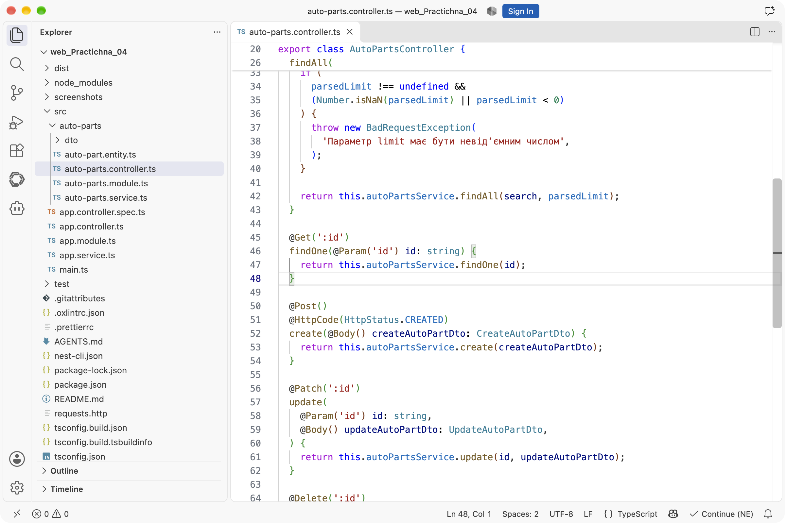
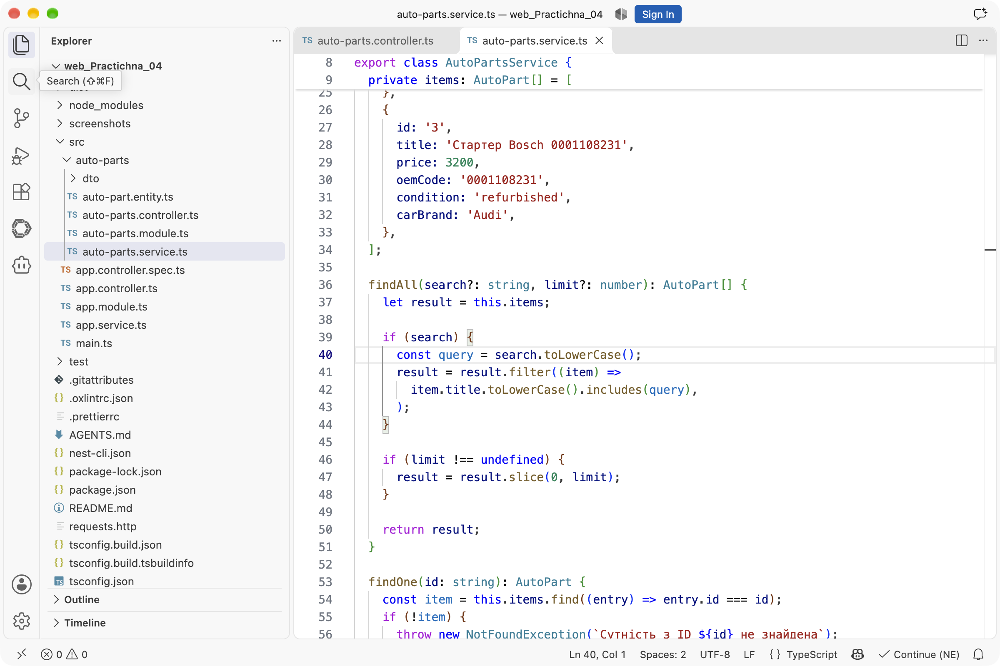
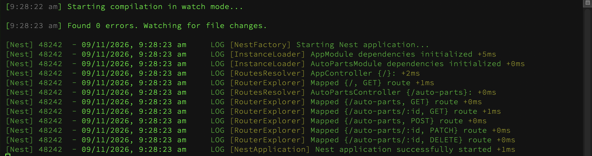
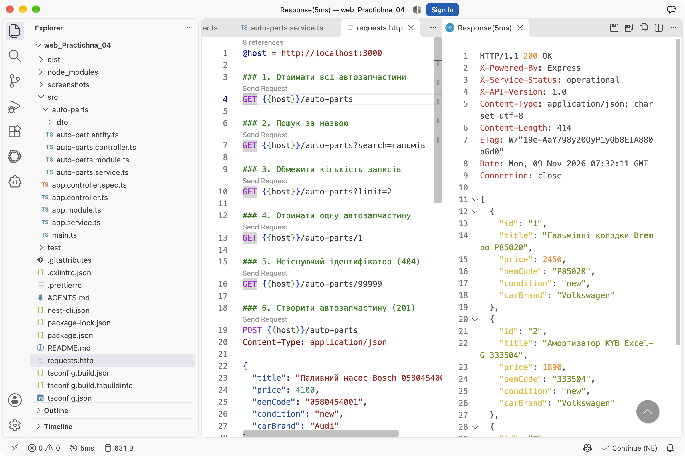
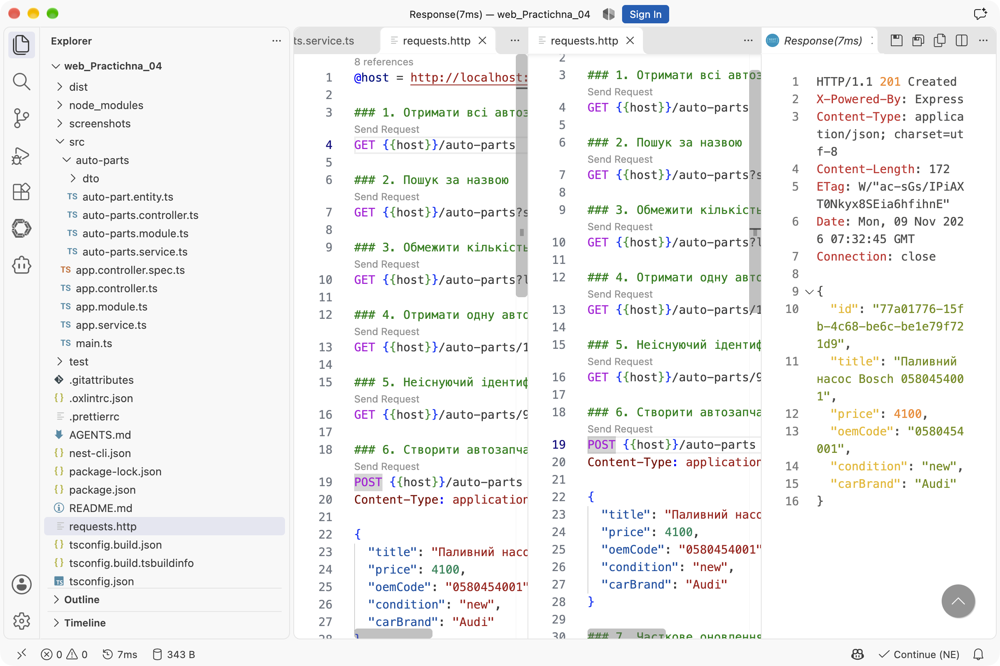
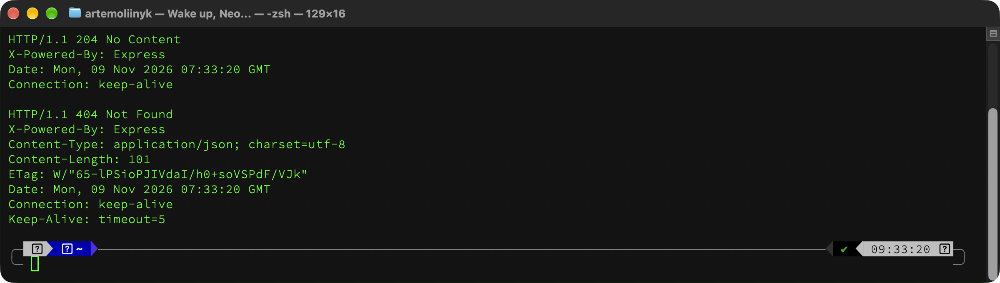
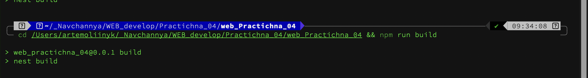

# Практична робота № 4

## Розроблення REST-ендпоінтів засобами NestJS

**Виконав:** Олійник Артем Сергійович
**Курс:** IV
**Група:** КН-43
**Дисципліна:** WEB-розробка
**Варіант:** 7 (автозапчастини, `/auto-parts`)
**Рік:** 2026

---

## Мета роботи

- Створити NestJS-проєкт за допомогою CLI та згенерувати ресурсний модуль.
- Реалізувати повний CRUD для сутності автозапчастини з типізованими DTO.
- Налаштувати query-фільтрацію, HTTP-заголовки, статуси `201` і `204` та обробку `404`.

## Середовище виконання

| Компонент | Версія |
|---|---|
| Node.js | 26.9.0 |
| npm | 11.19.1 |
| NestJS | 11 |
| TypeScript | 5.9 |
| ОС | macOS 26 |

## Структура проєкту

```text
web_Practichna_04/
├── src/
│   ├── auto-parts/
│   │   ├── dto/
│   │   │   ├── create-auto-part.dto.ts
│   │   │   └── update-auto-part.dto.ts
│   │   ├── auto-part.entity.ts
│   │   ├── auto-parts.controller.ts
│   │   ├── auto-parts.service.ts
│   │   └── auto-parts.module.ts
│   ├── app.module.ts
│   └── main.ts
├── requests.http
├── screenshots/
├── package.json
└── README.md
```

---

## Хід виконання

### Рівень 1. Проєкт, контролер і DTO

Проєкт створено через NestJS CLI:

```bash
npx @nestjs/cli new web_Practichna_04 --strict --package-manager npm
```

Контролер, сервіс і модуль згенеровано командами CLI:

```bash
npx nest g module auto-parts --no-spec
npx nest g controller auto-parts --no-spec
npx nest g service auto-parts --no-spec
```

Маршрут варіанта 7 - `auto-parts`. Модель описує поля `title`, `price`, `oemCode`, `condition` і `carBrand`:

```ts
export interface AutoPart {
  id: string;
  title: string;
  price: number;
  oemCode: string;
  condition: 'new' | 'refurbished';
  carBrand: string;
}
```

DTO створення містить обов'язкові поля, а DTO оновлення - ті самі поля як необов'язкові:

```ts
export class CreateAutoPartDto {
  title!: string;
  price!: number;
  oemCode!: string;
  condition!: PartCondition;
  carBrand!: string;
}

export class UpdateAutoPartDto {
  title?: string;
  price?: number;
  oemCode?: string;
  condition?: PartCondition;
  carBrand?: string;
}
```



### Рівень 2. In-Memory Service та повний CRUD

Сервіс зберігає записи в масиві й починає роботу з трьох тестових позицій. Пошук за ідентифікатором кидає стандартне виключення NestJS:

```ts
findOne(id: string): AutoPart {
  const item = this.items.find((entry) => entry.id === id);
  if (!item) {
    throw new NotFoundException(`Сутність з ID ${id} не знайдена`);
  }
  return item;
}
```

Створення генерує унікальний `id` через `randomUUID()`, а оновлення змінює лише передані поля:

```ts
create(dto: CreateAutoPartDto): AutoPart {
  const item: AutoPart = { id: randomUUID(), ...dto };
  this.items.push(item);
  return item;
}

update(id: string, dto: UpdateAutoPartDto): AutoPart {
  const item = this.findOne(id);
  Object.assign(item, dto);
  return item;
}
```

Сервіс впроваджено в контролер через конструктор. Для `POST` явно вказано `201 Created`, для `DELETE` - `204 No Content`:

```ts
@Post()
@HttpCode(HttpStatus.CREATED)
create(@Body() createAutoPartDto: CreateAutoPartDto) {
  return this.autoPartsService.create(createAutoPartDto);
}

@Delete(':id')
@HttpCode(HttpStatus.NO_CONTENT)
remove(@Param('id') id: string): void {
  this.autoPartsService.remove(id);
}
```



Після запуску `npm run start:dev` Nest піднімає застосунок на порту 3000 і реєструє всі маршрути:



### Рівень 3. Query-фільтрація, заголовки та тестування

Метод `findAll` приймає `search` і `limit`. Пошук виконується без урахування регістру, а `limit` перевіряється на від'ємне або нечислове значення:

```ts
@Get()
@Header('X-API-Version', '1.0')
@Header('X-Service-Status', 'operational')
findAll(
  @Query('search') search?: string,
  @Query('limit') limit?: string,
) {
  const parsedLimit =
    limit === undefined ? undefined : Number.parseInt(limit, 10);

  if (
    parsedLimit !== undefined &&
    (Number.isNaN(parsedLimit) || parsedLimit < 0)
  ) {
    throw new BadRequestException(
      'Параметр limit має бути невід’ємним числом',
    );
  }

  return this.autoPartsService.findAll(search, parsedLimit);
}
```

Список повертається з двома службовими заголовками `X-API-Version: 1.0` і `X-Service-Status: operational`.



Запити для перевірки збережено у файлі `requests.http`:

| Метод | URL | Очікуваний статус |
|---|---|---|
| `GET` | `/auto-parts` | `200` |
| `GET` | `/auto-parts?search=гальмів` | `200` |
| `GET` | `/auto-parts?limit=2` | `200` |
| `GET` | `/auto-parts/1` | `200` |
| `GET` | `/auto-parts/99999` | `404` |
| `POST` | `/auto-parts` | `201` |
| `PATCH` | `/auto-parts/1` | `200` |
| `DELETE` | `/auto-parts/3` | `204` |

Створення нової позиції повертає `201 Created` і згенерований `id`:



Видалення повертає `204 No Content` без тіла, а повторний запит до неіснуючого ідентифікатора - `404 Not Found`:



## Результати перевірки

| Перевірка | Очікування | Фактично | Результат |
|---|---|---|---|
| `GET /auto-parts` | `200`, 3 записи | `200`, 3 записи | успішно |
| `GET ?search=гальмів` | `200`, 1 запис | `200`, 1 запис | успішно |
| `GET ?limit=2` | `200`, 2 записи | `200`, 2 записи | успішно |
| `GET /auto-parts/1` | `200`, товар `id: 1` | `200`, товар знайдено | успішно |
| `GET /auto-parts/99999` | `404` | `404` | успішно |
| `POST /auto-parts` | `201`, новий `id` | `201`, `id` згенеровано | успішно |
| `PATCH /auto-parts/:id` | `200`, змінені поля | `200`, ціна і стан змінені | успішно |
| `DELETE /auto-parts/:id` | `204` | `204`, тіла немає | успішно |
| Повторний `GET` після видалення | `404` | `404` | успішно |
| Заголовки відповіді | `X-API-Version`, `X-Service-Status` | обидва присутні | успішно |

Компіляція `npm run build` проходить без помилок:



## Висновки

NestJS дає змогу описати REST-ресурс кількома файлами: контролер відповідає за маршрути й HTTP-статуси, сервіс - за бізнес-логіку та сховище, DTO - за контракт вхідних даних. Завдяки dependency injection контролер не створює сервіс вручну, а отримує його через конструктор.

Стандартні виключення NestJS автоматично перетворюються на коректні HTTP-відповіді: `NotFoundException` дає `404`, а `BadRequestException` - `400`. Декоратори `@HttpCode` і `@Header` керують статусом і службовими заголовками без ручного налаштування відповіді.

Query-параметри `search` і `limit` реалізовано в сервісі, тому контролер лише перевіряє вхідні дані й делегує роботу. Це залишає логіку фільтрації в одному місці та спрощує подальше підключення бази даних.

## Інструкція запуску

```bash
npm install
npm run start:dev
```

Сервер доступний за адресою `http://localhost:3000`. Перевірка ендпоінтів:

```bash
curl http://localhost:3000/auto-parts
curl "http://localhost:3000/auto-parts?search=гальмів"
curl "http://localhost:3000/auto-parts?limit=2"
curl http://localhost:3000/auto-parts/1
```

Для перевірки через VS Code відкрити `requests.http` і натиснути `Send Request` над потрібним блоком.
